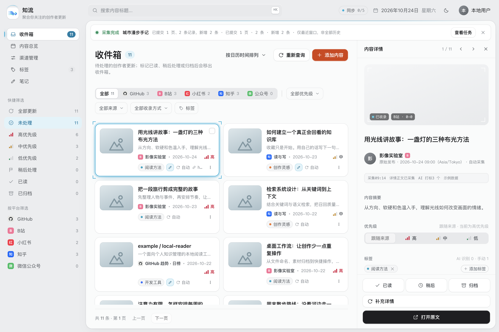
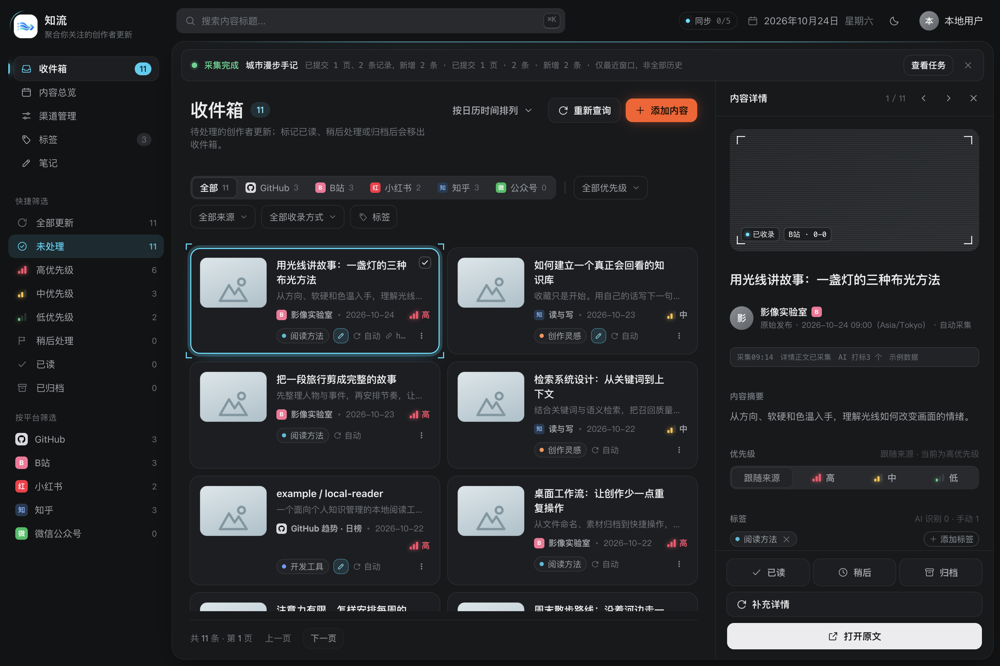
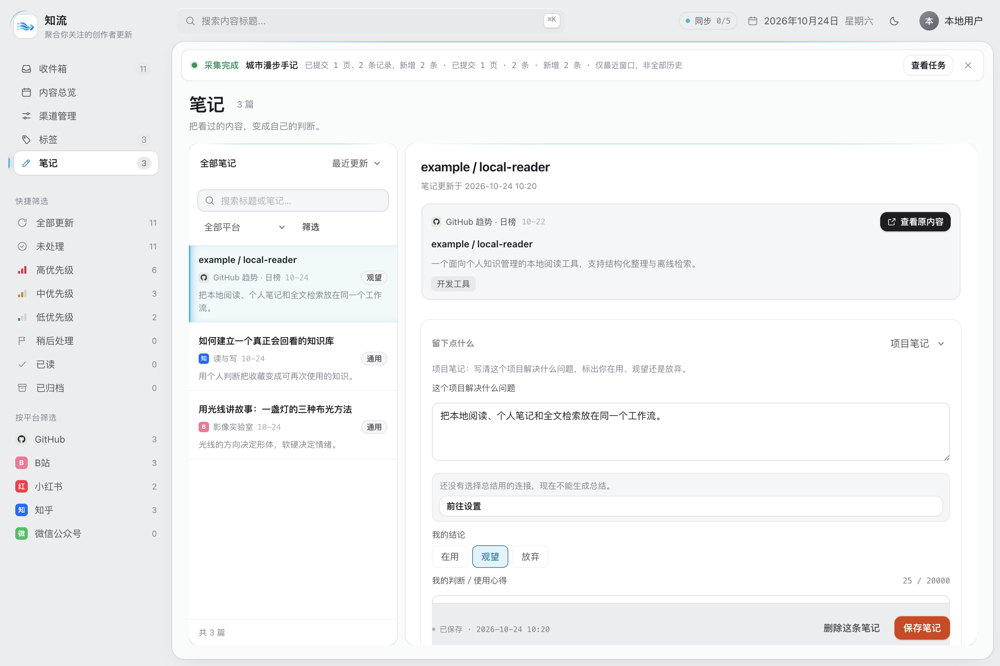
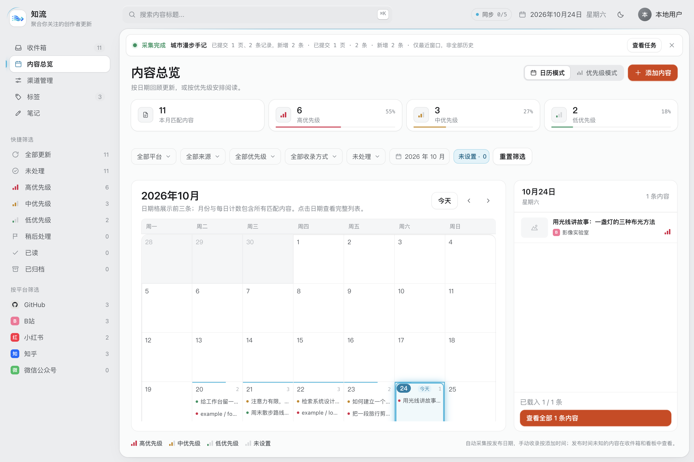
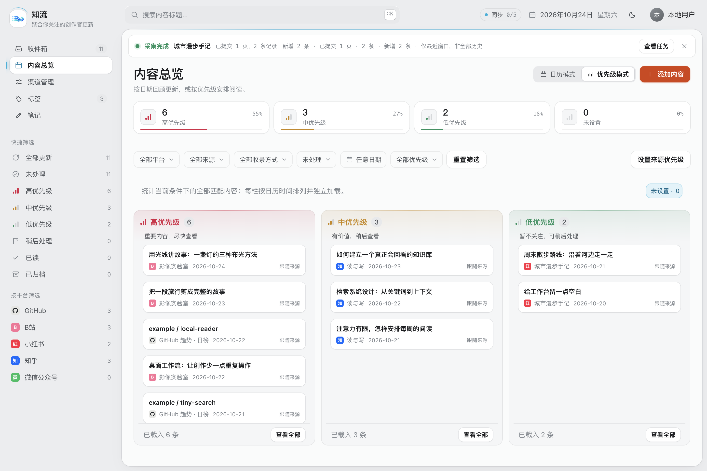
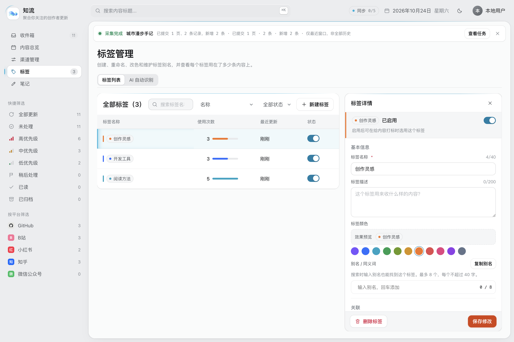
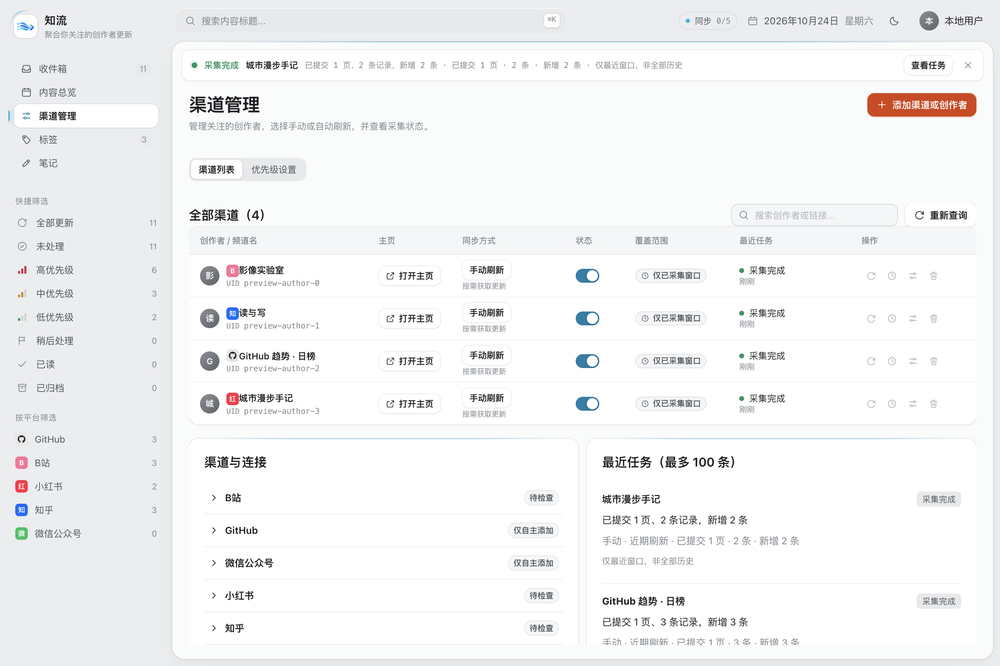
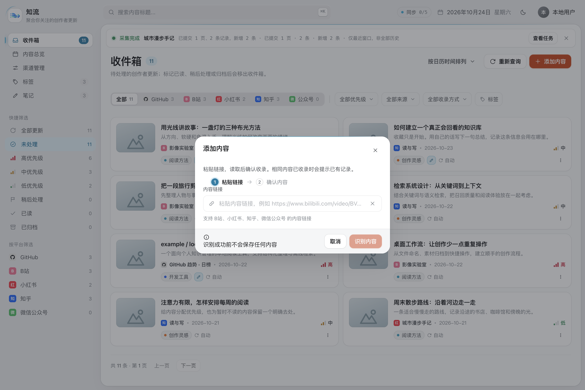

<p align="center">
  
</p>

<h1 align="center">知流 · Subscribe Flow</h1>

<p align="center">聚合你关注的创作者更新，把值得留下的内容收进自己的信息库。</p>

知流是一款本地优先的订阅与信息整理桌面应用。订阅作者、粘贴链接收录内容，在同一个收件箱中阅读与整理，再通过标签、优先级和日历找回需要的信息。

## 应用特点

- **多平台聚合**：把 B站视频、小红书笔记、知乎想法、微信公众号文章和 GitHub 项目放在同一个信息库中，按平台与来源查看。
- **订阅与主动收录**：持续关注作者更新，也能随时粘贴单条链接，把日常遇到的内容保存下来。
- **收件箱整理**：用已读、稍后处理和归档管理阅读进度，支持批量操作；处理后的内容仍可在对应分类和全部更新中找到。
- **留下点什么**：为内容写通用笔记或项目笔记，记录总结、个人收获，以及「在用／观望／放弃」的项目判断。笔记页支持标题目录、搜索、排序与组合筛选，可在当前页面查看完整原内容。
- **按需 AI 总结**：独立选择 AI 服务与总结长度，生成后先作为可编辑草稿，确认保存才进入笔记；不会替你填写个人收获或项目结论。
- **灵活的优先级**：为来源设置默认优先级，也可单独调整某条内容，在三栏看板中安排阅读顺序。固定高／中／低三级，支持自定义显示名称。
- **标签与组合筛选**：自定义标签名称与颜色，支持单条或批量打标、多标签任一或全部匹配，以及关键词、平台、来源、收录方式和处理状态筛选。标签列表支持按名称或使用次数排序。
- **AI 自动识别**：配置自己的 AI API，选择从已有标签中识别或允许模型生成标签；支持查看任务结果、重试和历史内容补打，并保护人工整理结果。
- **日历回顾**：订阅采集的内容按原始发布日期展示，手动收录的内容按首次添加时间展示，同时保留原始发布时间。
- **按需更新**：支持手动刷新、历史回溯和自动检查，可为订阅设置采集条数与检查间隔。自动检查需要应用保持运行。
- **后台运行与提醒**：支持托盘驻留和定时提醒，分别统计待处理内容与高优先级未归档内容；点击提醒可进入对应列表。关闭主窗口后可继续后台运行，选择「退出应用」才结束运行。
- **本地保存**：订阅、已收录内容与整理记录存储在本机；重复收录保留已有记录，刷新不会覆盖你的标签、优先级和处理状态。已保存的文字信息与整理记录可离线查看。
- **轻科幻界面**：统一纸面布局、平台标识与优先级信号条，支持浅色／深色主题和可关闭的视觉特效。分段控件切换带滑块动画，切换模式、筛选和后台更新时保持导航与阅读位置稳定。

### 支持的平台与内容

| 平台 | 内容类型 | 作者订阅 | 单条链接收录 |
| --- | --- | :---: | :---: |
| B站 | 视频投稿信息 | ✓ | ✓ |
| 小红书 | 笔记 | ✓ | ✓ |
| 知乎 | 作者发布的想法 | ✓ | ✓ |
| 微信公众号 | 文章 | — | ✓ |
| GitHub | 日／周／月 Trending 榜单中的项目、仓库信息 | ✓（榜单订阅） | ✓（仓库链接） |

> ⚠️ **小红书登录提醒**：建议使用小号登录。应用内登录也算一次 PC 端登录；如果在本机其他浏览器或客户端再次登录，有可能触发平台风控。

B站收录视频信息与原文链接，观看视频时打开原平台。知乎支持「想法」；微信公众号通过文章链接收录。GitHub 读取公开页面，无需登录；Trending 订阅限全站日／周／月榜，只能获取当期页面，不提供完整历史榜单，仓库内容按收录时间展示。平台读取需要联网，内容能否获取取决于登录状态与平台访问限制。

## 0.5.1 更新

本版带来笔记工作流与全新视觉界面：

- 新增「留下点什么」与独立笔记页，支持通用／项目模板、不写笔记、保存／删除、项目结论和原内容弹窗。
- AI 服务配置与自动打标、总结策略分开管理。总结支持简略／详细长度，结果进入草稿并保护用户在等待期间输入的文字。
- 按「静流」风格统一浅色／深色主题、纸面布局、图标和优先级信号条；品牌图标保留白底原图，外观设置可关闭轻科幻特效。
- 平台筛选、日历／优先级模式和页面分区使用分段滑块动画，尊重系统「减少动态效果」设置。
- 修复收件箱切换渠道时的骨架闪烁、栏宽和纸面高度跳变，以及总览／渠道／标签／笔记侧栏高亮闪烁。
- 完善来源筛选、当日内容列表、长文字边界、平台标识和笔记短窗滚动，保留后台刷新时的滚动、焦点与编辑草稿。

原有多平台收录、三级优先级别名、标签排序、AI 自动识别和后台提醒继续保留。详情装饰读数中标为「示例数据」的部分仍是视觉样例。

### 写笔记与生成总结

1. 在内容详情的「留下点什么」选择通用笔记或项目笔记，写下总结与自己的判断；不需要记录时保留「不写笔记」。
2. 如需 AI 总结，先在设置中配置 AI 服务，并在「AI 总结」中选择所用服务、长度与语言。
3. 点击「AI 总结」后可以继续编辑。检查生成的草稿，再点击「保存笔记」；已保存笔记可在侧栏「笔记」中查找与修改。

### 开始使用 AI 自动识别

1. 在「用户设置 → AI API 配置」填写所用服务的接口地址、模型与 API Key，保存并测试连接。
2. 在「标签 → AI 自动识别」选择识别方式并启用。只使用已有标签时，先在标签管理中创建并启用候选标签。
3. 新收录内容进入自动识别流程；已有内容可先预览历史补打范围，再主动执行。

AI 功能为可选项，需要自行提供可用的 API。识别时会将所需内容发送到所配置的服务，可能产生该服务的调用费用。

## 界面截图

| 收件箱与内容详情 | 深色主题 |
| :---: | :---: |
| <a href="assets/screenshots/inbox.png"></a> | <a href="assets/screenshots/inbox-dark.png"></a> |
| **笔记与个人判断** | **日历浏览** |
| <a href="assets/screenshots/notes.png"></a> | <a href="assets/screenshots/calendar.png"></a> |
| **优先级看板** | **标签管理** |
| <a href="assets/screenshots/priorities.png"></a> | <a href="assets/screenshots/tags.png"></a> |
| **渠道管理** | **链接收录** |
| <a href="assets/screenshots/channels.png"></a> | <a href="assets/screenshots/add-content.png"></a> |

以上截图均于 0.5.1 重新截取，使用隔离的示例内容；点击图片可查看大图。

## 如何安装

### 通过安装包

当前版本为 **v0.5.1 · macOS Intel（x64）**。

- [下载安装包](https://github.com/melon-bun/SubscribeFlow/releases/download/v0.5.1/Subscribe-Flow-0.5.1-mac-x64.zip)
- [SHA-256 校验文件](https://github.com/melon-bun/SubscribeFlow/releases/download/v0.5.1/Subscribe-Flow-0.5.1-mac-x64.zip.sha256)
- [发布说明与历史版本](https://github.com/melon-bun/SubscribeFlow/releases)

1. 获取安装包并解压。
2. 将 `Subscribe Flow.app` 拖入「应用程序」文件夹。
3. 打开知流。在「渠道管理 → 渠道与连接」展开对应平台，完成所需的应用内登录，再添加来源并刷新；也可点击「添加内容」直接粘贴链接。GitHub 榜单无需登录。

安装包已内置运行环境，无需额外安装 Node.js 或 Python。当前包采用本机签名，尚未经过 Apple 公证；首次打开可能出现 macOS 安全提示，可在「系统设置 → 隐私与安全性」中允许打开后重试。

升级时先退出应用，备份 `~/Library/Application Support/Subscribe Flow/`，再用新版替换原来的 `.app`。

自动检查与定时提醒需要应用保持运行；托盘不可用时，关闭主窗口会退出应用。

### 通过 npm 从源码运行

准备 **Git、Node.js 22.12+ 和 Python 3.12+**，并确保终端中可以使用 `python3`。

```sh
git clone https://github.com/melon-bun/SubscribeFlow.git
cd SubscribeFlow
npm ci
npm run configure
npm start
```

`npm ci` 安装依赖，`npm run configure` 配置本机运行环境，`npm start` 启动应用。后续在项目目录中运行 `npm start` 即可。

源码运行版与安装包默认共用本地数据目录，请退出其中一个后再启动另一个。
