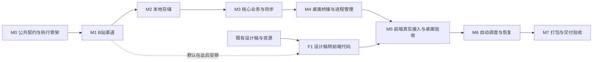

# Subscribe_Flow 模块化开发计划

2026-10-22 5.1 期完成：第五期之后补的界面优化任务，模块 M30–M32。已按仓库根目录 `zhiliu-visual-style.html`（「静流」）重构整个设计风格与设计原则，采用轻科幻 design token，**知流 logo 保持原样**。M30 令牌重构 `ed36d50` → M31 界面样式重构 `347246b` → M32 轻科幻层 `6c6d0bf`，分支 `feature/phase51-visual`（基线 `fb66b94`），Codex 实机验收通过（Node 142 项、主 Renderer 验收、M26–M29 实机脚本、新增 M32 专项验收 13 项断言）。快捷键不做；详情读数用假数据并标注「示例」，真实取数归 5.2 期。**未合并 main、未打包／推送／发布。** 详见 [5.1 期方案](../DEVELOPMENT_PLAN_PHASE51.md)。

2026-10-21 第五期开发：用户已授权原 MiniMax session 实现全部 M25–M29，Codex 分发与独立验收；M25 首批启动已确认，20 分钟定时跟进已启用。工作分支 feature/phase5-notes，详细状态见 [Phase5 分发记录](../PHASE5_TASK_DISPATCH.md)，不自动打包／推送／发布。

2026-10-21 第五期方案：已按用户修订整理 [留下点什么／笔记／独立 AI 服务](../DEVELOPMENT_PLAN_PHASE5.md)，模块顺延为 M25–M29，基线为已发布 0.4.9／main 93a9364。包含可选择不写笔记、标题目录与原内容 modal、独立 Provider 配置及总结设置；[UI 设计与五张示意图](../design/phase5/UI_DESIGN.md) 已归档。本次仅交付方案与 UI，产品开发未开始。

2026-10-21 用户追加：M21 的API通用文案去掉接口数量限制，标签AI页删除重复配置入口，原MiniMax已提交ffb4ca8，Codex验收通过。只验收这两项，未扩展主模块；见 [0.4.9计划第11节](../DEVELOPMENT_PLAN_0.4.9.md)。

2026-10-21：**0.4.9 六项优化（M19–M24）已完成开发与 Codex 必要源码验收**，最终产品提交 `08fb00f`（main）。MiniMax实现，Codex分发审查；BUG-043标签范围及BUG-103／104／105已验收。最终正式Main／Core／SQLite离线Renderer与刷新视图回归通过，真实登录／API／系统授权按用户外出指令保留人工清单。版本仍0.4.8，未打包、推送或发布；本轮跟进已暂停，不自动扩展工作。 [最终报告](../verification/v0.4.9-review/REPORT.md)。以下保留开发分发与历史记录。

2026-10-21：已编写 [0.4.9 优化版本开发计划](../DEVELOPMENT_PLAN_0.4.9.md)。源码基线 main `4704d12`、版本 0.4.8；计划包含 GitHub 黑色图标、三级优先级别名、AI API 与识别策略分离、标签点击跳顶修复、使用次数排序及渠道连接折叠列表。模块编号承接四点五期 M18，顺延为 M19–M24。用户已授权整轮由 MiniMax 实现、Codex 分发验收；M19–M23 已由 Codex 验收（含fca1ab8），BUG-043标签范围与BUG-105均关闭，最后模块M24已交原 MiniMax session，后续继续每 30 分钟跟进。需人工参与步骤先跳过或模拟并记录；标签跳顶反馈沿用 BUG-043。以下旧版进度按历史日期理解。

2026-10-19 最终发布：0.4.5已发布并完成线上核验（2026-10-19 17:46:17 JST发布，2026-10-19 18:17:14 JST核验），main／v0.4.5均a332e51，构建源9c4210e。BUG-097与替换BUG-098均验收；正式macOS x64包核心验收通过，线上安装包与校验文件大小／SHA一致。BUG-011用户搁置未解决，BUG-094、新签名钥匙串授权及原真实OS／长期范围继续记录。本跟进已暂停，不自动开始M19或下一组遗留。发布记录Subscribe_Flow/docs/RELEASE_0.4.5.md，当前遗留BACKLOG_STATUS.md。下文旧未发布／上传中状态均为历史。

2026-10-19 发布当前：0.4.5源码9c4210e已正式构建、核心安装包验收通过，main／v0.4.5已推送至a332e51。GitHub安装包与校验文件仍在后台上传，未核实完整上传前不称已发布；自动跟进保存PID与进度，完成后核对远端资产摘要再暂停。BUG-011搁置未解决；钥匙串授权和原真实OS／长期验证范围如实记录。

2026-10-19 发布当前：BUG-097／098均验收，本地main已快进合并完整分支至b8464de。原MiniMax r05-release仅做四处0.4.5版本准备，确认开始后待机；Codex随后正式构建、验证、推送与上传。尚未发布，不恢复BUG-011或要求用户登录。

2026-10-19 r04验收通过：BUG-097与替换BUG-098两项修复均由Codex验收；0acd56c的正式资源组装／asar验证通过，真实OS托盘仍未验证。开始已授权的合并main与0.4.5发布准备，实际构建／上传未完成前不写已发布。BUG-011用户搁置未解决继续披露。

2026-10-19 用户最新调整：BUG-011先搁置、仍未解决，用户出门暂不能登录，不再探测其平台／权限条件。替换为已确认的P1 BUG-098：正式打包遗漏托盘资源，安装包无法创建托盘；不依赖登录，交原MiniMax最小修复。BUG-097已验收保留。0.4.5发布门槛改为BUG-097与BUG-098两项，通过后继续已授权的合并main、打包与上传Git。Codex维护文档与验收，以下旧BUG-011阻止发布条件为历史记录。

2026-10-19 r03 当前：BUG-011 未解决，受限现场核查未完成且无新样本，现待外部原样本／可归因证据或执行条件变化；不反复空派。Codex 已记录宿主限制及验收入口自身问题，不采信“仅宿主故障”推断。BUG-097 验收保留；0.4.5 合并／打包／上传继续等待两项均验收。证据见 Subscribe_Flow/docs/verification/backlog-review/2026-10-19-r03-acceptance/REPORT.md。

2026-10-19 最新验收与发布授权：BUG-097 已在 26daa8a 经 Codex 验收通过（41 项聚焦测试及原失败场景恢复）；BUG-011 尚未定位／未修复，已交原 MiniMax r03 做一次原隔离会话受限核查，开始事件已确认；缺证据则外部待验收。用户明确授权两项均完成验收后合并 main、打包 **0.4.5** 并上传 Git；验收前保持原 MiniMax 分发／审查流程。当前发布门槛未满足，不提前合并或发布。执行计划 Subscribe_Flow/docs/RELEASE_0.4.5.md；下文旧“不打包发布”按其历史日期理解，由本条条件授权接续。

2026-10-19 遗留交付审查：BUG-097 原恢复有效，但正常详情更新后仍按旧内容版本跳过，续修原问题；BUG-011 未定位／未修复，缺原始条目或可归因复现。只继续已选两项的实质范围，不扩成第三项。当前事实以 Subscribe_Flow/docs/PROGRESS.md 与 BACKLOG_STATUS.md 为准。

2026-10-19 最新授权：只选取两项遗留交原 MiniMax session：P1 BUG-097（跳过／取消打标内容无法主动恢复）、P2 BUG-011（历史 B站 7 条未入库待定位）。Codex 分发、验收并同步文档。其余缺口按 Subscribe_Flow/docs/BACKLOG_STATUS.md 排序保留；不开始 M19、不打包发布。

2026-10-19 当前：M16–M18 本次返修已完成，BUG-095（4ff8093）及 BUG-096（0ab104c）均由 Codex 验收通过，M17 组合统计核查通过。非致命 BUG-094 与原实机／长期限制保留，仅记录，不继续派修；30 分钟跟进已暂停，不自动开始新模块。开发分支仍为 feature/m18-github-trending，未合并 main、推送或打包。详细证据见 [最终验收](/Users/xor/Documents/Subscribe_Call/Subscribe_Flow/docs/verification/m16-m18-review/2026-10-19-r02-acceptance/REPORT.md)。以下为历史阶段记录。

四期及四期半进度入口（2026-10-18）：[四期开发方案与计划](/Users/xor/Documents/Subscribe_Call/Subscribe_Flow/docs/DEVELOPMENT_PLAN_PHASE4.md)、[四点五期方案](/Users/xor/Documents/Subscribe_Call/Subscribe_Flow/docs/DEVELOPMENT_PLAN_PHASE45.md)。M15 已完成；M16 核心开发及必要验收已完成（MiniMax 产品修复 ef6e3bb，Codex 审查交付 698fb7d；19 项聚焦测试及 8 次真实模型产品调用通过），非致命 BUG-094 仅记录，不单独派修。BUG-061 仅作历史任务索引。M17 主体通过隔离真实进程验收，真实系统通知仍待人工确认；M18 已实现，开发分支仍为 feature/m18-github-trending，未合并 main、推送或打包。Jev 规则保留“达标项优先；全部低于 0.8 取分数前两名”。M16 跟进已暂停，不自动开始新模块。实际验证及限制见 docs/PROGRESS.md 与 [M16 最终验收](/Users/xor/Documents/Subscribe_Call/Subscribe_Flow/docs/verification/m16-review/2026-10-18-r02/REPORT.md)。

以下为三期及更早阶段的历史计划，实施状态按对应日期及各期文档理解。

当前状态：二期已完成并发布 v0.2.0；三期 M11 公共基础、M13 自主添加、M12 知乎想法、M14 微信公众号文章源码任务全部完成。M14 于 2026-10-09 通过隔离验收与真实平台验收，实施记录见 Subscribe_Flow/docs/DEVELOPMENT_PLAN_PHASE3.md。
更新日期：2026-10-09（Asia/Tokyo）
架构基线：[正式架构方案 v1.1](PLAN_v1.1.md)

三期顺序为 M11 → M13 → M12 → M14，四个模块源码均已在 main；M12 提交 `048deaa`，M13 功能提交 `01d48af`／前端 `91b5edf`，M12 131 项 Python、51 项 Node、正式知乎 Renderer、独立持久会话及旧功能回归通过，真实知乎账号验证按用户授权跳过。M14 复用「添加内容」粘贴微信公众号文章链接，经独立 WechatAdapter 返回标准内容，稳定身份为页面确认的 `__biz`+`mid`+`idx`，不创建公众号订阅或同步 Job，日历按首次添加时间；M14 的实现、验收与限制见三期计划。最新明确要求完成后不要打包，等待用户后续要求；未打包、未推送、未发布新版本。

范围与证据见 [三期计划](/Users/xor/Documents/Subscribe_Call/Subscribe_Flow/docs/DEVELOPMENT_PLAN_PHASE3.md)、[M11 交付说明](/Users/xor/Documents/Subscribe_Call/Subscribe_Flow/docs/M11_INTAKE_FOUNDATION.md)、[M13 实施说明](/Users/xor/Documents/Subscribe_Call/Subscribe_Flow/docs/M13_MANUAL_INTAKE.md)、[M12 实施说明](/Users/xor/Documents/Subscribe_Call/Subscribe_Flow/docs/M12_ZHIHU_PINS.md) 和 [M14 接入方案](/Users/xor/Documents/Subscribe_Call/Subscribe_Flow/docs/M14_WECHAT_ARTICLES.md)。以下一期、二期实施过程保留历史语境，当前进度以本摘要和三期计划为准。

## 1. 推进方式

采用“按模块交付、独立验收”的方式。先建立最小公共契约，随后立即实现 **B站渠道**；前端拆成 **F1 既有设计稿转代码**与 **M5 真实接口接入及桌面验收**，不再把全部前端工作推迟到 M5。

默认顺序为 **M0 → M1 → F1 → M2 → M3 → M4 → M5 → M6 → M7**。F1 先产出可复用的界面与交互，使用显式演示数据；M5 再接入 Python Core 和 Electron 桌面能力。当前优先完成 B站渠道，其他真实渠道仍留到后续。

### 前端时机评估

| 方式 | 收益 | 代价 | 决定 |
|---|---|---|---|
| 现在先完成全部前端业务 | 可较早看到完整外观 | 真实接口和状态尚未定型，容易把假设写进页面，增加联调返工 | 不采用 |
| 所有前端工作都等到 M5 | 接口较明确 | 已有设计稿无法提前验证，布局、交互和缺失状态的问题到后期才暴露 | 不采用 |
| 提前完成设计稿还原，M5 接入真实业务 | 提前验收界面，渠道变动集中在服务接口及状态映射处 | 需要一层轻量数据访问接口和可控演示场景 | **采用** |

这项安排基于“设计稿已经完成、渠道实现仍可能变化”的现状。F1 已由另一 Agent 在 `../Subscribe_Flow_F1/` 独立交付；M5 已沿用其布局、样式和组件接入正式工程，原工作区未改动。

每个模块开工时明确输入、输出、允许修改的边界和验收条件；完成时记录实际结果、未解决事项与后续依赖。模块内部的常规实现选择由开发时决定，不因每个字段或参数调整重新讨论整体架构。

渠道变化分两类处理：

- 命令、端点、认证、响应结构变化：在渠道实现和对应测试内解决。
- 影响统一内容、能力、错误或进度语义：记录公共契约变更，更新架构及受影响模块的测试，再继续集成。

B站出现外部环境阻塞时，已经独立的通用模块可以用脱敏样本和测试适配器继续开发；真实渠道未通过的部分仍保持未完成，不以模拟测试替代平台验收。

## 2. 模块顺序与依赖

图中实线为主要交付依赖，虚线标记 F1 的默认安排位置；具体逐模块顺序见第 1 节。代码依赖不等于顺序依赖：M2 的数据实现依赖 M0 的契约，不允许导入 M1 的 B站代码；F1 不依赖真实渠道、SQLite 或 Python 进程；M5 在 F1 与 M4 均完成后联调。

F1 所需设计稿入口或资源暂未就绪时，M2–M4 可继续推进，不必等待界面还原；F1 应在进入 M5 前独立验收。前后端分别推进时通过数据访问契约对齐，不重复实现一套业务核心。

| 模块 | 核心交付 | 前置条件 | 当前状态 |
|---|---|---|---|
| M0 | 契约、Gateway、可取消的工具执行与独立验收入口 | 正式架构 | 已完成，契约 1.0；macOS 执行边界验收通过 |
| M1 | B站搜索/定位、列表、分页、详情、状态和错误映射 | M0 | 部分完成：搜索、分页窗口及详情实测通过；全历史末页和 AV 输入未完成 |
| F1 | 已有设计稿转代码、可复用组件、交互与演示场景 | 设计稿及资源可访问；遵守正式架构，不依赖 M1 完成 | 用户确认已完成；交付位于 Subscribe_Flow_F1，M5 沿用设计与组件 |
| M2 | 数据模型、迁移、repository、幂等与一致性提交 | M0；参考 M1 的标准化结果 | 已完成，事务/去重/配置快照/一致性备份通过 |
| M3 | 订阅管理、手动刷新、回溯任务、查询和内容状态 | M1 + M2 | 已完成通用闭环；真实 B站入库 20 条通过，全历史能力仍受 M1 限制 |
| M4 | RPC、Preload、Core 生命周期和最小窗口 | M3 | 已完成，真实 Python sidecar 与 Electron 联调通过 |
| M5 | F1 界面接入真实业务 API、桌面能力与完整流程验收 | F1 + M4 | 应用内会话与正式界面已接入，用户反馈基本可运行；旧 OpenCLI 问题移出桌面路径，本次登录正常，10 页回溯 193 条入库，7 条解析错误待定位，其他平台专项待补齐 |
| M6 | 定时刷新、公平调度、等待恢复、重启与休眠恢复 | M3 + M5 | 已实现并通过隔离验收：默认手动、自动默认 24/最大 72 小时；实机长周期观察待后续 |
| M7 | macOS 独立应用、内置 Core、数据升级和首期集成验收 | F1 + M0–M6 | 部分完成：本机打包/离线验收通过；列表回溯存在 7 条解析错误；其他平台专项与长周期/物理休眠待验收 |

首期完成 F1 和 M0–M7。内容整理增强、第二个渠道分别作为后续模块，不阻塞 B站第一版。设计稿即使展示后续功能，也不代表这些功能自动进入首期业务范围。

## 3. M0：公共契约与渠道执行骨架

**目标：让渠道能独立开发、独立运行、独立验证。**

工作范围：

1. 建立 Python 工程、测试入口与最小模块目录，固定依赖管理方式。
2. 落实 ChannelDescriptor、Source、ContentItem、FetchRequest / FetchPage、Readiness、ChannelError 等公共类型及契约版本。
3. 实现薄 Gateway 和显式注册，不扫描/安装任意第三方插件。
4. 实现 CLI Transport：通过参数数组启动工具，限制执行时间与输出、支持取消、清理本任务子进程，并脱敏诊断。
5. 建立共享资源协调接口；浏览器资源由连接绑定，工具执行不得私自绕过资源限制。
6. 提供 `channel_probe` 独立入口，调用真实 Adapter；不在验收工具里复制平台逻辑。
7. 建立仅供测试使用的 Adapter，能模拟正常返回、连接阻塞、部分结果和错误。

交付位置：`python/src/subscribe_flow/contracts/`、`channels/gateway.py`、`acquisition/`、`python/tools/channel_probe.py` 及对应测试。

验收：

- 不启动 Electron、不使用业务 SQLite，就能通过 Gateway 调用测试 Adapter。
- 正常结果、超时、取消和阻塞具有明确且不同的输出。
- 工具进程被取消后可清理；输入参数不经 shell 拼接执行。
- contracts 不导入具体平台、数据库或桌面实现。

边界：不实现完整调度器、内容管理 UI、数据库层，也不建立复杂插件市场。这里只准备 B站接入所需的最小基础。

## 4. M1：B站渠道（首个业务模块）

**目标：独立完成“定位指定用户 → 分页读取投稿 → 返回统一内容与明确覆盖范围”。**

默认实现：`BilibiliAdapter + BilibiliOpenCLIBackend`。使用真实外部浏览器环境，具体登录要求通过操作级验证确定。历史公开搜索 API 可以作为备选方案研究；如果改变默认实现，在 B站模块文档中记录理由，不把两套采集方式提前全部实现。

### M1.1 环境和能力确认

- 记录 OpenCLI 版本、运行环境、浏览器连接方式、所需依赖及检测方法。
- 检查当前命令帮助与输出结构，再复现历史 `user-videos` 成功路径；不能只看到命令存在就判定可用。
- 分别记录搜索、作者列表、详情的认证与依赖条件。浏览器未连接与登录失效分开；不为验证而擅自注销用户已有会话。
- 登录边界无法安全实测时保持“未确认”，按已有可用会话运行，不宣称匿名可用；错误分支可先用样本测试。

交付：`../doc/channels/bilibili.md`（相对工程根目录）中的环境、能力与证据表。

### M1.2 作者定位与搜索

- 支持 UID 和合法主页链接，输出规范化 Source。
- 验证作者搜索返回可用的稳定 UID，结果供用户确认。
- 同名作者不自动合并；解析 UID 与远程确认作者存在分开处理。
- 如果 OpenCLI 搜索不能提供可靠 UID，评估历史搜索 API 作为该操作的替代实现；尚未完成时只开放 UID/主页入口，搜索仍标为待完成。

### M1.3 视频列表与标准化

- 用投稿列表读取能力获取标题、BVID、链接及可获得时间等信息。
- 统一 AV/BV 表达；BVID 作为首期视频内容 ID。
- 区分真实值、缺失值和工具占位值；时间保留精度与来源，未确认的日期时区不得伪装成精确时间。
- 单条结构异常记录为条目错误；整页结构不兼容返回明确错误，不伪装成零投稿。

### M1.4 分页与全历史能力

- 验证页码/limit 实际语义、不同页返回内容、排序、置顶和末页判断。
- 向 Core 返回下一页定位与结束证据，不在 Backend 内承担业务数据库或长期调度。
- 独立验收入口可循环调用公开分页契约，枚举一个具有多页投稿的可控规模作者，验证到达真实末端与去重数量。
- 处理重复页、无进展页、请求失败以及扫描期间列表移动。无进展不能直接作为“全量完成”的证据。
- 如果后端只能读取有限窗口，能力表和结果必须标明限制；“全历史”验收保持未通过，不能以最近 20 条替代。

### M1.5 详情、连接状态与错误映射

- 将视频详情作为可选补充操作，列表获取不依赖每条详情都成功。
- 将浏览器未连接、认证问题、访问挑战、超时、限流和输出结构变化映射成统一状态。
- 历史出现的 `Navigation rejected` 不直接等同于登录失效；根据实际证据分类，无法判断时保留未确定的访问失败。
- 为恢复操作提供明确说明；Backend 不替 Core 修改订阅状态。

### M1.6 渠道验收与交接

必须交付：

- B站 Adapter、Backend、解析器和能力声明。
- 脱敏后的作者/列表/多页/详情/失败样本及契约测试。
- 独立验收入口的实际结果记录，包括访问方式、所需环境、验证范围和未确认条件。
- `../doc/channels/bilibili.md`（相对工程根目录），记录恢复方式、分页边界、版本和已知限制。

验收矩阵：

| 场景 | 通过标准 |
|---|---|
| 作者 UID / 主页定位 | 得到同一个稳定 Source；无效输入有明确错误 |
| 作者搜索 | 返回可确认的候选及稳定 UID；不会误订阅同名作者 |
| 最近投稿 | 返回真实非空标准内容，原始字段不泄漏成上层业务格式 |
| 多页历史 | 多页读取至可靠末端；去重后可说明实际覆盖范围 |
| 重复页面 / 异常空页 | 不错误宣告全历史完成，也不无限循环 |
| 单条详情失败 | 列表结果保持可用，错误仅影响详情操作 |
| 依赖或认证阻塞 | 明确作用域与恢复方式，无假空结果 |
| 取消 / 超时 | 在执行边界停止，并释放本次工具资源 |

平台可用性的真实 smoke test 与离线测试分别报告。至少定位、投稿列表和多页遍历必须有真实验证；不能以模拟数据宣布 B站完整可用。搜索或全历史仍未通过时，M1 标记部分完成，后续通用模块可继续，但不得标记对应产品能力完成。

**本模块不依赖小红书原型，不实现其他渠道，不开发完整桌面 UI。**

## 5. F1：既有设计稿转前端代码

**目标：将已有设计稿转成正式应用可继续使用的前端代码，先独立验收视觉与交互，再由 M5 接入真实业务。**

### F1.1 开工输入与范围核对

- 确认设计稿入口、采用版本、页面清单，以及可获得的图标、图片、字体等资源。输入已由 F1 交付，来源与页面映射见其 IMPLEMENTATION.md。
- 将设计页面对应到首期时间线、订阅、任务、渠道与连接功能；后续功能记录为预留项，不能因出现在设计稿中就扩展后端范围。
- 盘点设计稿已覆盖和缺失的交互状态；常规状态可沿既有风格补齐，影响主导航、业务范围或主要流程的缺口记录后再确定。
- 沿用 Electron Renderer 的原生 JavaScript / HTML / CSS 技术栈；设计稿或导出代码使用其他框架时先记录差异，不自动改变项目技术栈。

### F1.2 布局、样式与可复用组件

- 提取颜色、字体、间距、尺寸等基础样式，按设计稿实现布局、导航和首期页面。
- 将列表项、筛选控件、表单、对话框、状态提示等按实际复用需要拆分；不为每个视觉元素建设组件框架。
- 实现主要窗口尺寸下的缩放、滚动、长标题、长列表和弹层显示；补齐键盘焦点和基本可访问名称。
- 代码直接归入 `electron/renderer/`，提供可在浏览器中启动的开发预览；M5 继续使用同一套页面，不另写一次界面。

### F1.3 演示数据与数据访问边界

- 页面只调用轻量 `AppClient` 接口，表达内容查询、来源解析、订阅操作、任务与连接状态等业务需求。
- F1 提供异步的演示实现；M4/M5 提供调用受限 Preload API 的真实实现。通过开发启动配置选择实现，不在各页面散布 mock / real 判断。
- 根据正式架构先定义最小页面数据形状与事件说明，记录暂定字段；与 M0 标准模型、M3 业务 API 对齐。前端 DTO 不直接等同数据库表或 OpenCLI 原始输出。
- 筛选、分页、表单校验、对话框与任务进度可通过可控场景交互；演示中的新增/暂停等变更仅影响临时演示状态，不表示已经落库或访问平台。
- 本地筛选选择、弹窗和临时输入由 UI 管理；真实订阅、内容整理状态及任务进度以 Core 为准，不让演示存储演变成第二套业务数据库。
- 演示模式明确标识；真实服务失败时展示对应错误，不自动切回演示数据。正式交付默认只使用真实实现。

### F1.4 状态与交互验收

除正常内容外，至少能独立展示：首次使用/空列表、加载、错误、连接阻塞、依赖不可用、同步进行中、部分成功、能力不支持，以及有限窗口与历史遍历完成的差异。场景中的渠道能力可配置，不按 B站名称写死按钮逻辑。

不需要先实现真实刷新、数据库持久化、浏览器登录或自动调度。设计稿中的相关入口先由演示实现驱动，最终能力在 M5/M6 验收。

交付物：

- `electron/renderer/` 下的正式页面、样式、可复用组件、数据访问接口与开发预览入口。
- 隔离在开发用途目录中的演示数据及状态场景，不向生产页面注入隐式假数据。
- `../doc/frontend/IMPLEMENTATION.md`（相对工程根目录）：设计稿来源与版本、页面对应关系、数据访问契约、预览方式、缺失状态处理及待接入清单。
- 主要页面与关键状态的截图/视觉对照记录，用于说明还原差异与验收结果。

验收标准：

1. 不启动 Python、SQLite、OpenCLI 或 Electron Main，即可预览并操作首期页面。
2. 与采用版本的设计稿逐页比对，主要布局、层级、样式和交互符合设计；差异有明确记录。
3. 关键交互及异常状态可以通过确定性的演示场景复现；演示内容不会被标成真实采集成功。
4. 页面不直连平台，不访问数据库，也不包含命令或认证处理；切换数据访问实现无需重写页面布局。
5. 已明确哪些功能仅完成了展示/演示，哪些需要 M5 的真实流程验证；F1 完成不等于产品功能完成。

## 6. M2：本地存储

目标：为统一数据提供可靠、可迁移的持久化，渠道无需感知数据库。

工作范围：确定 Source / Subscription / Connection、内容与来源关联、ContentState、任务记录及同步进度的具体 schema；实现 repository、迁移、索引、统一写入与短事务；定义后端切换和取消订阅时的数据保留规则。

交付：`storage/`、迁移与存储验证、schema 说明。数据库路径来自应用配置，不依赖开发目录。

验收：同一批内容重复写入不重复；更新来源内容不改用户状态；取消订阅保留历史；分页入库失败可回滚；未完成扫描不推进完整 checkpoint；刷新进度与历史回溯互不覆盖；迁移及一致性备份可恢复。

边界：不允许 repository 调用 B站工具，也不把认证秘密写入业务数据库。

## 7. M3：核心业务与手动同步

目标：脱离 UI 完成实际订阅闭环。

工作范围：

- SubscriptionService：添加、确认、暂停、恢复、取消和连接绑定。
- SyncService：手动刷新、首次获取、历史回溯、详情补充；统一任务入口和运行记录。
- QueryService：按来源、渠道、时间等读取分页内容与任务状态。
- ContentService：提供基础用户内容状态变更接口，不在此阶段铺开复杂分类产品功能。2026-10-05 用户确认“已读 / 稍后处理 / 归档”只能单选：选择一项原子取消另两项，取消当前项回到未处理；详情、菜单与批量操作一致，旧多重状态备份后归一化，见 BUG-005。
- 串接 Gateway 与 repository，完成分页提交、配置版本校验、去重、失败作用域和取消。
- 将历史回溯拆成可让出资源的批次；安全恢复无效游标时重扫，保证内容幂等。

交付：`application/`、启动组装、无 UI 的业务集成验收，以及业务 API 清单。

业务 API 与 F1 的页面需求清单对齐，明确实际数据、分页、错误和事件语义。演示数据中未被后端支持的字段或动作要显式调整，不能要求 Core 为迁就假数据而暴露平台细节。

验收：添加 B站作者后能刷新和回溯、查询已保存内容；重复点击刷新能合并或返回已有任务；中途失败保留已提交内容且不越过失败区间；恢复后可继续或安全重扫；详情失败不影响列表；修改连接后旧任务不能覆盖新配置进度。

使用测试适配器覆盖不同鉴权条件，确认 Core 没有 `if channel == bilibili` 等平台专属采集分支。

## 8. M4：RPC、桌面桥接与进程管理

目标：Electron 通过稳定业务接口使用 Python Core。

工作范围：JSON-RPC over JSON Lines、请求校验和协议握手；任务 ID 与事件；白名单 Preload API；Core 启停、异常和受控重启；最小 Electron 窗口和本地 UI 加载。

交付：`rpc/`、`electron/main/`、`electron/preload/`，以及协议/事件说明。

同时落实 F1 数据访问接口到 Preload 业务方法的映射，并定义事件订阅与释放方式；完整页面联调留在 M5。

验收：查询、添加订阅、启动任务、取消任务能经桥接完成；进度事件不阻塞 UI；重启后重新查询恢复状态；日志不会混入协议；无效方法和参数有明确错误；Renderer 无任意命令/SQL入口；关闭时只清理本应用创建的采集资源。

边界：不为接入 OpenCLI 默认开放 Electron 调试端口，不将平台页面嵌入应用作为本期前置条件。

## 9. M5：前端真实接口接入与桌面验收

目标：将 F1 已验收的界面接入真实业务和 Electron 桌面环境，使用户可以完成 B站订阅与内容查看。前置条件为 F1 和 M4 均完成。

接入工作：

- 实现正式 AppClient，统一调用受限 Preload API；生产启动使用真实实现，演示实现仅供显式开发预览。
- 将页面查询、订阅变更、任务操作和状态事件接入 M3/M4，处理事件释放、过期响应及重复提交。
- 接入真实持久化、窗口重开与 Core 重启后的状态恢复；真实错误保持可见，不使用演示结果掩盖。
- 在 Electron 窗口中验证字体、资源路径、缩放、滚动、弹窗、键盘操作及安全的原文打开，修复浏览器预览与桌面运行的差异。
- 如接口实测要求补充状态，沿用既有设计组件完成，记录必要变化；不重新制作整套页面。

页面范围：

- 时间线：列表、基础筛选、分页、内容摘要与原文打开。
- 订阅管理：UID/主页输入、已验收的搜索入口、作者确认、暂停/恢复/取消。
- 刷新与回溯：手动开始、进度、取消、部分结果及覆盖限制。
- 渠道与连接：依赖状态、认证状态、最近成功/失败和恢复操作。

本轮范围（2026-10-04 用户确认）：沿用 `Subscribe_Flow_F1/electron/renderer/` 的布局、样式和组件；补齐作者解析/搜索与确认、分页、日期精度、任务/连接状态、安全原文打开、窗口及 Core 重启恢复。未实现的优先级/规则/标签等能力明确停用，不以演示数据替代；自动调度仍留 M6。

交付：正式数据访问实现、联调后的 `electron/renderer/`、更新的 `../doc/frontend/IMPLEMENTATION.md` 及真实交互验收记录。

验收：能够添加作者并看到实际采集的内容；UI 按能力描述开放入口；“没有新内容”和“读取失败”有区别；“最近窗口”和“历史枚举完成”有区别；重新打开窗口后可恢复任务和内容状态；不在前端拼装 OpenCLI 参数。

视觉与主要交互以 F1 的设计稿还原结果为基线。本模块验收真实流程；自动触发和长期运行恢复由 M6 验收。

本轮实际结果：35 项 Python、8 项 Node 测试及 M4/M5 离线桌面验收通过；首次真实 UID 闭环读取 20 条投稿、已读保存和重启恢复通过。随后搜索两次及列表再次复验遭遇 OpenCLI Navigation rejected，详情扩展未执行到；搜索成功、详情、实时回溯/重试仍需外部环境恢复后复验。不得据首次成功宣布当前平台稳定可用。详见正式工程 docs/PROGRESS.md 和 docs/frontend/IMPLEMENTATION.md。

## 9.1 M5 补充：应用内 B站会话与采集稳定性（2026-10-04 用户指定）

当时 M6 暂缓。用户已明确要求在 M6 前完成此项，无需再次请求开工确认；2026-10-05 用户已要求继续 M6，见第 10 节。
现有 OpenCLI 依赖外部 Chrome，间歇出现 Navigation rejected；改为 Electron 自有持久会话，
使用隔离的 WebContentsView 展示 B站官方登录页，通过同一 Session 执行限定的只读采集。
本补充覆盖前文 M1/M4/M7 关于 B站默认依赖外部 Chrome/OpenCLI 的旧安排，旧实现保留供历史回归。

工作与验收范围：
- F1 连接区提供应用内登录与真实会话检查；登录只在 B站官方页面完成，Cookie 留在 Electron 独立会话目录。
- 搜索、投稿列表和详情使用应用内会话，不启动 OpenCLI，不读取外部 Chrome 配置或 Cookie。
- 保留平台响应状态码，区分未登录、需交互、限流、临时网络错误、结构变化与有效空结果；串行采集，取消及时释放资源。
- 后端切换提升连接版本，使旧分页进度失效；保留订阅、内容和阅读状态。
- 验证应用重启、关闭登录窗口后采集、分页/详情、失败恢复及无外部浏览器依赖。真实登录由用户完成，不自动转用外部会话。
- 更新问题记录、桌面说明、交接和开发进度，提交 Git。未完成真实平台验证的部分必须如实记录。

2026-10-04 补充结果：已实现应用内会话与迁移；41 项 Python、14 项 Node、离线正式界面和 Session 隔离持久化通过。新匿名会话真实投稿收到 -352，登录后专项实测待完成。用户随后反馈基本可运行并于 2026-10-05 要求继续 M6。

## 10. M6：自动调度与运行恢复

当前状态：2026-10-05 已按用户要求实现并通过隔离验收：52 项 Python、16 项 Node、正式 Electron Renderer 流程通过。真实 24–72 小时长周期及物理休眠未作长时间实机验收；测试采用可控时钟与电源事件注入。用户反馈手动采集基本可用，未扩大此前平台验证结论。详见 ../Subscribe_Flow/docs/M6_SCHEDULING.md。

目标：把已可手动运行的同步流程变为可靠的持续追踪。

工作范围：持久化计划、到期入队、共享浏览器资源限流、退避、任务公平性、等待连接恢复、Core 异常/重启与电脑休眠恢复。定时任务复用 M3 的入口和提交逻辑，不另写一套采集流程。

验收：

- 到期任务自动运行，手动与定时请求不造成重复采集任务。
- 多个订阅共享连接时受统一资源限制；长历史任务不会永久占用资源。
- 登录/依赖阻塞不会持续刷失败日志或反复触发访问挑战；恢复后逐步执行。
- 中断任务可恢复或安全重扫；已存内容和用户状态保持一致。
- 休眠期间不会声称仍在采集；恢复后分批补调度，不同时启动全部积压任务。
- 查询和本地内容整理不因渠道暂时失效而不可用。

具体刷新间隔、预算、并发与退避数值根据 B站实测确定，并写入可配置策略。

本轮实施范围（2026-10-05 用户补充）：每个订阅默认手动模式，已有订阅升级后同样保持手动；用户可切换手动/自动模式。
自动刷新间隔由用户自定义，默认 24 小时，最大 72 小时；界面保存模式与间隔，切回手动后停止自动调度。
每轮自动刷新 1 页，共享资源串行并留出请求间隔。计划与阻塞持久化；手动和自动任务合并，临时错误有限退避重试，登录/交互/解析阻塞等待明确恢复。
重启和唤醒后错峰补一次到期检查，中断扫描从头安全重扫，保留已有内容与处理状态。
沿用 F1 渠道页面展示模式、刷新频率、下次检查和等待原因；增加隔离数据库、可控时钟及正式桌面验收。
所有新发现的 Bug 按 BUG_FIXES.md 统一维护，完成后更新 docs 并提交 Git。

## 11. M7：打包与首期交付

当前状态：2026-10-05 用户确认开工，M7 实现 `70c6d0e` 已提交 main，macOS Intel `.app` / ZIP 已交付，打包与离线集成验收通过。
55 项 Python、18 项 Node、正式 Renderer、Session 与真实打包应用验收通过。升级整体回滚、备份不覆盖、移出项目启动、无开发 PATH、崩溃恢复、缺少 Core 提示均验证。
更正（18:21 JST）：此前 12:49 / 16:10 脚本复用 10 月 4 日等待任务，不能证明登录后请求失败。实际打包界面显式重试并确认新任务，读取 10 页 / 193 条、error=null，但 item_errors=7，属于部分完成（BUG-011）；本次未复现 -352。搜索/详情/连续刷新与实际 24–72 小时/物理休眠仍待验收，故 M7 保留部分完成。
已按追加要求审查并合入 Minimax 最新 5a3bff0 与 5fedf6f，所有进度入口和 development_plan 同步更新。详细交付说明：../Subscribe_Flow/docs/M7_DELIVERY.md。

目标：从桌面直接启动，不依赖开发终端、外部 Python/Node、OpenCLI 或 Chrome。
首期在当前 macOS Intel（x64）验收；Apple Silicon、Windows、Linux 尚不列为已支持。

工作范围：

1. 用 PyInstaller 打包 Python Core（含 SQLite 迁移），与 Electron 一起产出 macOS `.app` 和可分发压缩包；固定构建依赖和可复现入口。
2. 正式包只使用内置 Core 和应用内 B站 Session。启动检测给出可操作错误；生产包不包含测试数据、本机路径配置、用户数据或测试入口。
3. 保持稳定的应用数据目录；验证升级、备份、失败迁移回滚和重启，保留订阅、内容与单选状态；记录登录会话的保留及失效恢复方式。
4. 从桌面启动打包产物，在隔离数据目录验证真实桥接、本地内容整理、任务取消、崩溃恢复、模式切换、会话持久化和缺少内置资源时的提示。
5. 独立记录平台实测与 M6 长周期/物理休眠验收。未通过或尚未执行的条件保持待验收，不用离线样本替代真实平台结论。
6. 更新 README、docs/PROGRESS.md、docs/HANDOFF.md、docs/DESKTOP.md、开发计划及交付说明；Bug 统一进入 docs/BUG_FIXES.md，代码与文档提交 Git。

验收：可移动 `.app` 后从桌面运行，清空开发 PATH 仍能启动真实 Core；数据升级/重启与失败恢复保持一致；无外部 Chrome 依赖；测试与用户日常数据隔离；安装包中无演示或隐私数据。
M7 完成需交付物与验收条件均满足。局部外部阻塞须保留具体待验收项，不能直接标记首期全面完成。
本轮为本机交付，对外发布、Developer ID 签名/公证和其他系统支持另按需求执行。

## 12. 后续独立模块

2026-10-06：用户已授权二期 M8 开工，并先合入 enhancement 分支。后续按 M8 优先级与可视化 → M9 标签与 AI 扩展接口 → M10 小红书推进，权威二期计划位于项目 `docs/DEVELOPMENT_PLAN_PHASE2.md`；实现与验收记录见 `docs/M8_PRIORITIES.md`。用户补充要求二期整体完成前不再打包，各模块先进行源码和开发环境验收，最后统一制作安装包。

2026-10-06（由 minimax 执行）：用户授权 M9 开工，分支 `feature/m9-tags`。开工前确认的四项交互决定为：标签管理入口采用侧栏独立「标签」视图；标签颜色采用 11 档固定色板（不做自由取色）；首轮支持批量打标（复用 M8 批量入口）；多标签筛选同时提供「任一符合」与「全部符合」两种语义。另经用户确认，**F2 设计的「标签规则」整页（含规则引擎与规则试跑）不纳入 M9**，本期只做标签列表页与 AI 识别空态页。范围与决定的完整记录见 `docs/M9_TAGS.md`，权威二期计划 `docs/DEVELOPMENT_PLAN_PHASE2.md` 已同步修订。M10 小红书仍排在最后。

2026-10-07：M9 合并前审查发现的问题已在 feature/m9-tags 修复（ad4ee9e），91 项 Python、26 项 Node 与完整正式 Renderer（含优先级、日历、标签、重启／重载）通过，随后快进合入本地 main。未推送、未打包；M10 尚未开工。最终记录见 Subscribe_Flow/docs/M9_REVIEW.md 和统一 BUG_FIXES.md。

2026-10-07（M10 范围细化）：用户确定只订阅小红书作者更新；添加作者采用昵称搜索并由用户确认候选账号。采用「实现小红书用户搜索 Demo」的方案 A（直接读取应用内页面），日常隐藏网页，首次使用／登录失效时沿用 B站应用内登录与连接恢复。作者主页先读取笔记 ID，跳过已完整收录的详情，保留新笔记及未完成记录补全，不在首个旧 ID 处停止；不将 demo 的最近 48 小时直接用作订阅更新限制。范围与验收见 Subscribe_Flow/docs/DEVELOPMENT_PLAN_PHASE2.md 第 5 节和 docs/M10_XIAOHONGSHU.md。当前是范围对齐记录，尚未实现。**最新打包安排：M10 完成后也暂不打包，先体验与处理 Bug／优化，等待后续明确要求；覆盖此前二期完成后统一打包的安排。**

### 内容整理增强

围绕已经稳定的 ContentItem / ContentState 开发类别、优先级、归档、搜索、日历与统计。具体交互和优先顺序开工时确定，不引入与平台采集方式的耦合。

### 第二个渠道及后续渠道

按新模块重复 M1 的开发与验收方式：能力确认 → 身份与列表 → 分页/详情 → 错误与状态 → 独立验证 → 注册接入 → 产品集成验收。

小红书在轮到该模块时再审查原型作为参考，不要求照搬其结构，也不在本轮提前重构。新增渠道不得要求复制一套 Core、数据库流程或时间线页面。

## 13. 模块完成记录与当前下一步

每个模块（包括 F1）开工前汇报目标、范围与验收条件；用户提出细化需求时同步更新计划。完成时将状态表更新为实际状态，并记录：

1. 完成的能力和交付位置。
2. 验收命令或操作、实际结果、使用的是离线样本还是真实环境。
3. 未验证条件、已知限制、阻塞及其影响范围。
4. 公共契约是否变化，以及哪些模块需要相应调整。
5. 下一模块可直接使用的接口和样本。

只有交付物和验收条件均满足，模块才标记完成。部分完成可以继续推进独立工作，但必须保留未通过项目。

### 2026-10-05 当前进度与下一步

- M6 已实现：默认手动，可切自动；默认 24 / 最大 72 小时，有限重试、错峰恢复与状态持久化。
- BUG-001–005 修复见统一记录；最新 BUG-005 将已读/稍后处理/归档统一为互斥状态，SQLite v3 升级前备份。
- main 已合入 `5a3bff0` 界面优化及 `5fedf6f` 审查修复（新原因/任务重新显示提示）；BUG-006/007 修复随 M7 提交。
- M7 本机交付完成，列表回溯有 7 条解析错误待定位，其他平台专项与长周期/物理休眠保持待验收；优先级/分类增强与第二渠道尚未开工。

### 2026-10-03 历史实施记录

工程位于 `../Subscribe_Flow/`，已建立独立 Git 仓库（main）和 `.gitignore`，按模块提交。
F1 由另一 Agent 制作，本轮仅只读其 AppClient 契约，不修改其文件。

- M0：公共类型、显式 Gateway、共享资源锁、带超时/取消/输出上限的参数数组执行器、独立验收入口。
- M1：Bilibili Adapter、OpenCLI 1.8.8 Backend、严格解析及错误映射。真实作者搜索成功；独立入口两页各 5 条，共 10 个不同 BVID；详情成功。记录见 [B站验收](channels/bilibili.md)。
- M2：SQLite schema、迁移、repository、幂等提交、用户状态隔离、进度隔离、配置版本检查及一致性备份。
- M3：订阅确认、手动刷新/回溯/详情、任务合并/取消/重试、查询与内容状态。真实 Core smoke 入库 20 条并保存已读状态；回溯完整性仅由可靠契约证据决定。
- M4：JSON-RPC 1.0 握手、参数校验、进程生命周期、白名单 Preload、F1 AppClient 映射及最小联调窗口。重启保留数据；非法方法被拦截。

验收结果：34 项 Python 离线测试、3 项真实 sidecar 测试、真实 Electron 联调通过。
真实采集与桌面测试分开：桌面 smoke 用临时数据库和显式缺失 OpenCLI，未宣称 F1 正式页面流程已验收。

关键边界：OpenCLI 当前丢弃总数/末页及上游状态码，空数组无法可靠区分无投稿与访问失败，
因此 `full_history=false`，空结果返回 UNVERIFIED_EMPTY，不能以窗口读取成功替代全历史完成。
当时 AV 号输入不支持，匿名认证条件未确认。以下下一步是该日历史安排，当前下一步见上节。

当时下一步：F1 交接后进行 M5，使用现有 AppClient 桥逐页联调；优先级、分类和自动规则按后续范围处理。
同时继续补齐 M1 的可靠末页元数据及历史验收，不把未通过能力改标为完成。

交接文件：[实施记录](../Subscribe_Flow/docs/PROGRESS.md)、[业务 API](../Subscribe_Flow/docs/API.md)、
[桌面和 F1 对接说明](../Subscribe_Flow/docs/DESKTOP.md)、[存储约定](../Subscribe_Flow/docs/STORAGE.md)。

## 仓库同步记录（2026-10-05）

2026-10-05 已完成两次 Git 历史清理：两个分支的全部提交均已移除 `docs/`、handoff Markdown、`AGENT.md` 和 `CLAUDE.md`；本地文档继续保留并被忽略。已推送至私有仓库 [melon-bun/SubscribeFlow](https://github.com/melon-bun/SubscribeFlow)，默认分支 `main`，当前提交 `8967692`；`feature/enhancements-minimax` 为 `5fedf6f`。旧 Git bundle 已同步清理。所有文档提交引用已更新至最终历史。

2026-10-07：用户明确授权 M10 开发，分支 feature/m10-xiaohongshu。另强调渠道 Adapter 相互解耦、故障渠道可以独立替换：平台页面／会话实现限制在渠道后端，Adapter 不依赖数据库或界面；Core 通过统一契约提供已收录身份、来源上下文并持久化标准内容。当前开发中，完成后暂不打包。

2026-10-07 M10 当前验收：主要实现、99 项 Python、35 项 Node、正式 Renderer 隔离站点与跨应用进程会话通过。真实平台登录已确认，影视飓风隐藏搜索与少量采集验收通过（两轮共 4 条，第二轮跳过 2 条完整记录，错误 0，核心重启仍为 4）；未打包、未推送、未合并 M10，长期运行与全部历史未验收。详见 Subscribe_Flow/docs/M10_XIAOHONGSHU.md。

M10 实现提交 `8de30a6`（feature/m10-xiaohongshu），工作区干净；源码及本轮真实专项验收通过，未合并到 main、未推送、未打包。

## 2026-10-07 M10 追加调整（用户授权）

1. 笔记外部链接必须通过详情页“分享／复制链接”取得官方分享地址，保留该地址中的分享参数与 token；主页签名链接仅用于内部读取，稳定笔记 ID 仍独立去重。按用户后续要求，不兼容旧笔记：删除独立验收目录原 4 条笔记，保留订阅／登录，由用户重新采集。
2. 小红书搜索期间禁用添加对话框的全部按钮与输入（包括平台切换、取消与关闭），设置 60 秒超时，超时停止后台操作并恢复控件，过期响应不得覆盖新的搜索。
3. 添加来源的平台选择改为可点击的渠道按钮，不再使用下拉列表。

同步 M10、API、交接、进度与渠道说明；docs/reference/channels/xiaohongshu.md 补写实际接入及验证记录。继续保持 Adapter 解耦、隐藏采集，不打包。

M10 追加调整隔离验收通过：99 项 Python、36 项 Node、正式小红书及 B站 Renderer；真实隐藏分享已取到正确地址，完整 API／打开链接复验通过，作者／笔记匹配、全程隐藏、验收库保持 0。渠道说明已补充至 Subscribe_Flow/docs/reference/channels/xiaohongshu.md。

M10 分享链接、60 秒搜索锁定与渠道按钮调整已提交 `135d69d`，全部本轮验证通过，工作区干净，未打包／推送／合并。

## 2026-10-07 BUG-042：小红书已收录笔记占用检查名额

按用户纠正，小红书“采集条数”是从主页起始位置按顺序检查的不同笔记数，不是新增详情数。检查到已完整收录的笔记时也消耗 1 个名额，跳过详情但不继续向后补足；缺失或失败的详情同样不向窗口外补位。窗口内仍检查其他笔记，避免把第一条旧／置顶内容当成终止信号。刷新／回溯、手动／自动遵循同一规则。

例如设置 5，前 5 条中 3 条已收录，只读取另外 2 条详情；前 5 条全部已收录则读取 0 条详情，不扫描第 6 条补位。通过标准预算单位表达，Core 不引入小红书特例。

BUG-042 实现及验证通过：100 项 Python、39 项 Node、正式小红书隔离 Renderer；不向窗口外补位，用户数据未操作。

BUG-042 修复提交 `5e079c5`（feature/m10-xiaohongshu），工作区干净，未打包／推送／合并。

## 2026-10-07 内容列表体验修复（用户授权）

- BUG-043：同一内容分区内点击／勾选／整理内容及异步刷新保留滚动位置，覆盖收件箱、全部更新与其他分类，并处理共用滚动列表的重绘。
- BUG-044：项目移出收件箱后选择原顺序下一条，末尾回退上一条；处理分页补位、末页清空、批量移出和操作失败。
- 采用界面层通用状态保存，不向渠道 Adapter 引入列表或选中状态。正式 Renderer 在隔离数据中验证，不操作日常数据，继续不打包。
- 实现与验收通过：39 项 Node、完整正式 Renderer（新增列表状态专项，含异步加载、失败写入、批量、分页、空态及总览滚动；原优先级／日历／标签／崩溃恢复／重载回归）。提交 `9e63cc3`；未打包、未推送、未合并。

## 2026-10-07 v0.2.0 发布（用户明确授权）

用户要求将版本更新至 0.2.0 并打包，已确认推送 main 并发布 GitHub v0.2.0 Release（含安装包），覆盖此前暂不打包的安排。构建当前已验收的 M8／M9／M10 与 BUG-043／044 修复；当前构建范围 macOS Intel x64。版本同步 Electron 与 Python Core，打包后验证独立启动、版本、旧数据迁移、标签、小红书能力与通用整理流程。构建／验收使用隔离数据，保留日常数据库与会话。当前进行中。

v0.2.0 构建及真实安装包隔离验收通过，100 项 Python、39 项 Node 通过，产物 SHA-256：`03f89fa211dfb7ce126bf7673fa10f0e5f19395b9d5852de59237196589c1684`。构建基线 `eaf7a9a`，正在发布 main 和 v0.2.0 Release。

v0.2.0 已发布：main / v0.2.0 指向 `3dc66de3e86e2ef169b4cf4d9da41864959f6a91`，Release：https://github.com/melon-bun/SubscribeFlow/releases/tag/v0.2.0。安装包与 SHA-256 文件上传成功，线上摘要与本地一致；工作区干净，日常数据库与会话未操作。真实安装包、100 项 Python、39 项 Node 与小红书隔离 Renderer 验证通过。

## 2026-10-08 M11 公共收录与日期基础完成

源码提交 `0511468`，分支 feature/m11-intake-foundation；120 项 Python、43 项 Node、完整正式 Renderer 与小红书隔离 Renderer 通过。schema v8、契约 1.1、独立收录任务及桌面接口、首次收录不可变／重复 no-op、统一时区日期查询均已落实。M13 的真实链接读取与添加界面、M12 知乎想法尚未开工。本次未打包、推送、合并或发布；三期全部完成并通过验收后再统一打包。实际范围见项目 docs/M11_INTAKE_FOUNDATION.md。

## 2026-10-08 开发分支安排更正

按用户澄清，本项目后续直接在 main 开发，另开分支须由用户明确要求。M11 提交 0511468 已快进合入本地 main，工作区干净；未推送、未打包。原 M11 完成记录中的未合并状态为合并前历史。

## 2026-10-09 M13 完成与验收

用户授权直接在 main 审查并提交其他 agent 的自主添加前端，再继续 M13。前端审查提交 `91b5edf`，修复 BUG-048／049；功能提交 `01d48af`，修复 BUG-050。两个现有 Adapter 新增链接匹配、稳定身份解析及单条内容读取；正式界面完成预览保存、重复提示、真实来源与收录方式筛选、日历／看板联动。Core 不增加平台分支，不创建虚拟订阅或同步 Job。

125 项 Python、46 项 Node、正式 Core 自主添加 Renderer、完整旧 Renderer、小红书订阅隔离回归及最终界面验收通过。B站真实视频、小红书真实笔记均完成识别、保存、重复 no-op 和重启验证；小红书已在独立官方验收窗口完成重新登录，原待登录项已解除。短链的有界跳转与身份标准化通过固定响应测试，本轮真实平台验证标准视频／官方分享笔记，未声明真实短链全面测试。

M13 已完成，源码工作区干净。M12 尚未开工，需按项目约定先汇报并取得用户确认。未打包、未推送、未发布，版本仍为 0.2.0；详细证据见 Subscribe_Flow/docs/M13_MANUAL_INTAKE.md。

## 2026-10-09 M12 知乎作者想法交付

用户授权直接在 main 按原型及三期文档完成 M12，遇到扫码先跳过，用隔离假数据等方式验证，完成后不要打包。该指令覆盖此前三期完成后的统一打包安排，本轮只提交源码。

已完成独立知乎应用内会话、昵称搜索／候选确认、平台稳定作者 ID、作者发布想法窗口、完整纯文本正文／图片想法／原始出版精度、既有订阅及 Scheduler／取消／等待重试，以及官方想法单条链接通过已有 IntakeService 预览／保存。两路径同一 ID 保留首次完整记录，Core 无平台分支，schema／契约不变。

131 项 Python、51 项 Node、最终专项、正式知乎 Renderer、两个 Electron 进程间持久会话、M13 双渠道收录、完整旧 Renderer 和小红书隔离回归通过。真实账号登录和站点读取按用户要求跳过，不能把模拟结果当成真实平台通过。M11、M13、M12 开发完成，版本仍 0.2.0；实现、证据和限制见 Subscribe_Flow/docs/M12_ZHIHU_PINS.md。

M12 最终源码提交 `048deaa`（main）；工作区干净，文档保持本地忽略。未打包、未推送、未发布。

## 2026-10-09 M14 微信公众号文章规划

用户在三期新增 M14，微信公众号当前只通过自主上传方式接入，先写方案。沿用 M13 的单条链接输入、预览和保存，新增 WechatAdapter 的 match_item_url／resolve_item／read_item，不实现公众号订阅、搜索、列表采集、刷新、回溯或自动调度。保存真实公众号 Source 与 article 内容，复用现有 schema v8、契约 1.1、首次收录及原子 no-op，手动文章按添加时间入历。

用户提供 mp.weixin.qq.com/s/ 文章形式，并确认正文能正常打开，应用内浏览器也可打开。本次自动请求先后取得错误页与 403，经排查确认为读取环境问题而非链接异常：出口 IP 被判异常时同一条链接经 curl、Python、Node、真实 Chrome 全部返回 403 空响应体（对微信根页与伪造不存在的文章 ID 得到相同 403，证明是 IP 整体风控）；切换出口 IP 后返回 200 与约 3.6 MB 正文，标题、作者、发布时间、正文及配图均解析成功。另确认默认 UA 会拿到 200 状态的验证页（响应体仅数 KB）而补全 UA 后取得正文，两者状态码相同、不能只看状态码判断。M14 第一阶段用该样例验证应用自有后端的稳定公众号／文章身份、正文及链接别名，再做渠道、界面能力过滤与相关验收。详细方案见 Subscribe_Flow/docs/M14_WECHAT_ARTICLES.md。

同日按用户要求补充采集异常规则：目标页面返回验证／风控页时，**停止该次采集**，不重试、不轮询、不降级其他抓取方式、不保存任何片段或空壳记录，按 `INTERACTION_REQUIRED` 终止并向用户提示可能原因（出口 IP 风控、UA 被识别、请求过密、文章本身受限）及可自助处理方向。判断依据为响应体特征而非 HTTP 状态码。详见 M14_WECHAT_ARTICLES.md 第 6 节及 6.1。

M14 方案已编写，未开工；本轮只改文档。顺序为 M11 → M13 → M12 → M14。后续直接 main 开发；不打包、不推送、不发布，等待用户后续明确要求。

## 2026-10-09 M12 真实平台采集 BUG-054 修复

用户真实登录知乎后反馈无法采集指定用户的想法。定位为 M12 采集路径依赖已失效的页面 DOM 与 403 接口：知乎主页「他的动态」改为客户端异步加载，服务端输出空壳，`discovered` 恒为 0，任务以 `scan_bound` 空转；`members/<token>` 与 `search_v3` 返回 403 code 10003，而 `/me` 仍正常，导致界面显示已连接却采不到内容。

修复后主页发现改用官方 `members/<url_token>/pins` 分页，单条详情改用 `pins/<id>`，作者稳定 ID 取自 pins 响应，昵称搜索改用 `api.zhihu.com/search_v3`；仅平台 `paging.is_end` 判定页末，空作者按零结果正常结束，富文本正文统一转纯文本。Core、契约 1.1、schema v8 不变。

已用真实 `persist:zhihu` 会话端到端验证：登录检查、搜索、作者解析、订阅扫描 3/3 条 0 错误、单条读取全部通过。Node 53 项、Python 131 项全量回归通过。源码未提交、未打包、未推送、未发布，版本仍 0.2.0。详见 Subscribe_Flow/docs/BUG_FIXES.md BUG-054。
