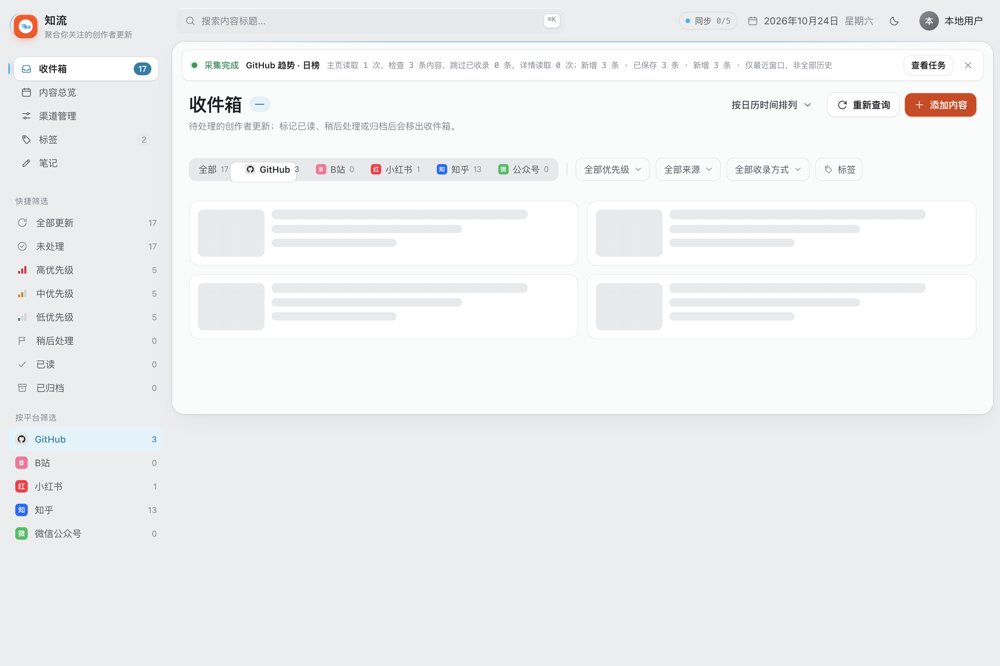
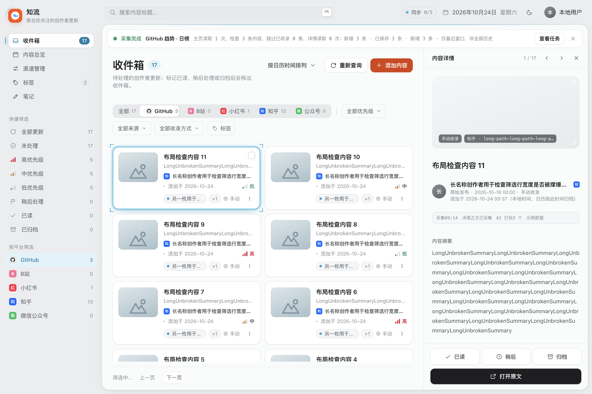
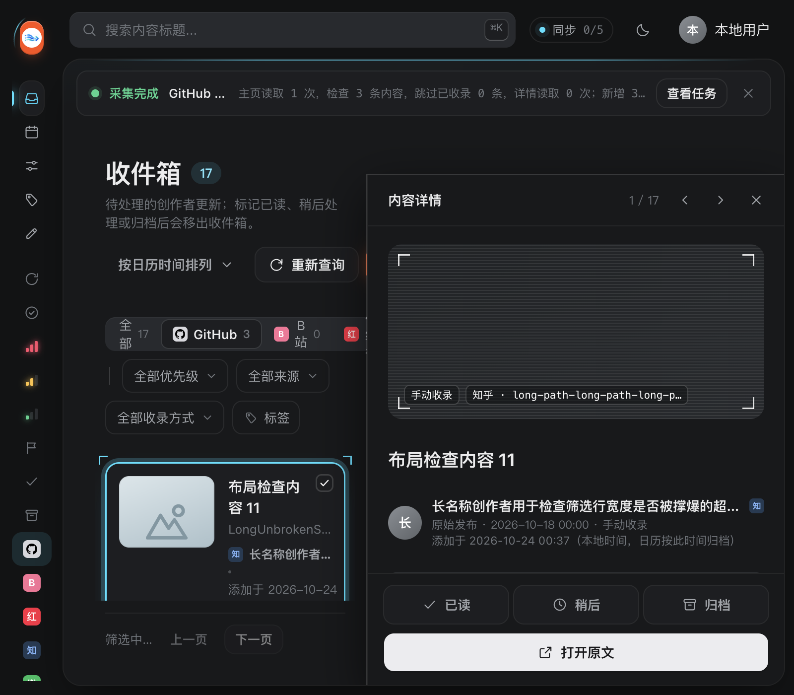

# BUG-102：主动切换筛选闪烁修复验收

日期：2026-10-24（Asia/Tokyo）。基线 `0a15ab9`，产品／验收脚本提交 `7852826`（本地 main）。
统一问题与状态见 [BUG-102](../../BUG_FIXES.md)，10 月 23 日的
[原因调查](../phase51/inbox-switch-investigation/REPORT.md) 保留为修复前证据。

## 修复结果

顶部平台分段、侧栏平台、来源／优先级／快捷筛选及搜索改为局部更新。
新的查询身份与已显示快照分开：查询期间保留原列表、总数、详情和纸面几何；
收到当前请求的有效回包后一次替换。列表与详情在加载中暂不可操作，页脚显示“筛选中…”。
失败保留快照并显示明确错误和“重试筛选”，不会把旧内容当作新筛选结果。
真正的空结果在回执后进入空态；筛选完成仍保留原有首条自动选择行为。
用户关闭详情后，后台同查询刷新仍保持关闭。

来源目录不随查询条件清空；独立失效代次防止在途目录回包覆盖更新。
下拉组件带选项签名，目录异步到达时即使按钮文案未变，菜单回调仍更新。
清除搜索同时清空保留下来的顶栏输入框；后台刷新不覆盖未提交的输入。

样式生成器将产品侧栏适配为 `grid-row:1`，并重新生成 CSS。
参考页中顶栏与纸面是根网格的两个子项，产品将它们包在 `.shell` 内，故不能照搬跨两行。
该有意适配消除了加载期间多余空行与纸面高度缩短。

## 修复前后对照

正式 Main/Renderer/Core，17 条合成内容，1440×960；拦住列表回执观察逐帧状态。
旧版本使用相同专项，首条检查即如实失败；新增验收入口以外未改旧产品源码。

| 指标 | 修复前 | 修复后 |
| --- | --- | --- |
| 顶部平台切换骨架帧 | 20 | 0 |
| 旧节点断开帧 | 20 | 0 |
| 纸面／主区／标题位置跳变帧 | 20 | 0 |
| 纸面高度（切换前 → 加载中） | 876 → 537px | 890 → 890px |
| 主区宽度（切换前 → 加载中） | 782 → 1182px | 782 → 782px |
| 标题 top（切换前 → 加载中） | 142 → 134px | 142 → 142px |
| 根网格行高（切换前 → 加载中） | 946/14 → 607/353px | 单行 960 → 960px |
| 单纯切换筛选的来源目录额外读取 | 1 次 | 0 次 |

原始数据：[修复前失败](before/checks.json)、[修复后 26 项](after/checks.json)。
节点连接检查监测 app、侧栏、顶栏、纸面、收件箱视图、列表与详情；筛选按钮本身可按状态更新。
逐帧计数为隔离样本的实际采样次数，不表示日常库耗时或所有设备的帧率。
新结果非空且原详情已打开时，回执后的纸面、栏宽和标题位置也逐项校验保持稳定。
原先关闭详情时，加载保持单列，真实结果到达后按原有交互打开首条；真实空结果允许进入单列空态。

已逐张查看上述修复后截图；本轮不扩展窄窗既有详情浮层或总览布局修整。

## 实际执行的验证

所有以下检查通过；未在产品源码上删减原业务断言。

| 检查 | 结果与证据 |
| --- | --- |
| `node scripts/inbox-switch-renderer.cjs` | **26/26**；[检查结果](after/checks.json) |
| `npm run smoke:refresh:ui` | **0 次纸面替换、0 骨架帧**；[结果](background/result.json) |
| `node scripts/refresh-inbox-channels-smoke.cjs` | 后台数据保留、请求竞态、在途失效排空、读取失败恢复、渠道开关焦点通过；[输出](refresh-views.log) |
| `node scripts/renderer-smoke.cjs` | 完整正式离线 Main/Renderer/Core；重启与重载持久化通过；[输出](renderer.log) |
| `node scripts/m35-details-renderer.cjs` | **38/38**；[检查结果](m35-details/checks.json) |
| `node scripts/seg-glide-renderer.cjs` | **21/21**；[检查结果](seg-glide/checks.json) |
| `npm test` | **142/142**；[输出](node.log) |

主动切换专项包含：顶部切换特效开／关、侧栏平台、来源与优先级下拉、快捷筛选、
800×700 深色、加载态只读、来源文案稳定、真实 Core 查询结果对照、回执后几何、
快速切换的乱序回包、读取失败／重试、空结果、原先关闭详情、在途失效补查及离页迟到回包。

连续采集回归包含纯进度不查内容、持续内容事件、成功／失败／取消／中断终态、
焦点与输入选区、正文选区、阅读锚点、错误恢复及离页保护，最终 76 条隔离数据一致。
主 Renderer 另覆盖并发刷新排空、写锁、分页与选择、优先级继承／覆盖、日历和标签。

现有后台夹具早于笔记功能：补齐 `getNote` 的空笔记和 `getSettings` 的关闭总结返回，
以便正式 Renderer 走现有契约；未改产品笔记实现。
主 Renderer 重启后检查从仅等待“20 张卡片”改为同时等待当前收件箱查询完成，
随后仍断言已读条目已移出及 Core 持久状态不变，避免误读保留中的旧快照。

## 交付边界

- BUG-102 的主动切换范围已修复，原后台采集刷新结论经当前源码复验仍有效。
- 全部验证使用合成库、隔离窗口或离线夹具；无真实平台／模型请求，无日常库或登录状态操作。
- 版本号仍为 0.4.9，仅本地源码提交；未打包、推送或发布。
- 总览与参考页的其余布局差异保持暂缓。
