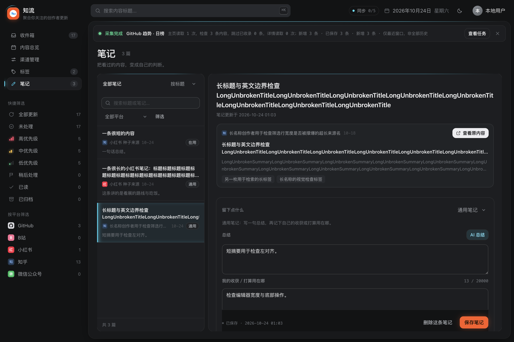

# BUG-102：四页模式切换与侧栏高亮续修

日期：2026-10-24（Asia/Tokyo）。基线 `ef176ef`，产品与专项脚本提交 `34a2a3f`（本地 main）。
统一问题沿 [BUG-102](../../BUG_FIXES.md)，上一轮收件箱修复见 [前批验收](../bug-102-switch/REPORT.md)。

## 调查结论与修复

有两条残留路径：

1. 内容总览／渠道管理／标签的模式或页签会改变同一页面的地址参数，通用 hashchange 仍调用全局 render。
   整个 app、侧栏、顶栏和纸面被替换，侧栏选中态在新节点挂载后才补上，重新触发颜色过渡。
   总览的一部分筛选按钮也直接调用全局 render。
2. 笔记本身已有局部刷新；但笔记／标签计数到达后会重建侧栏模板。
   模板不带高亮，协调时先移除旧按钮的 `is-active`，再由 syncNavState 补回。
   四个页面共享这条计数刷新路径。

修复后，普通页面内部的地址参数变化沿用外壳，只协调纸面内容；设置页仍走独立布局。
渠道与标签即时切换也改为局部协调，总览全局筛选入口同步收敛。
侧栏的主导航／快捷筛选／平台项在构造时直接携带正确选中态，后续同步仅在状态真正变化时写 class。
清除总览搜索仍同步顶栏输入框。未禁用过渡、未修改滑块动画实现，未改变业务查询或页面布局。
真正跨页的草稿离开确认保留。

## 修复前后的实际证据

正式 Main/Renderer/Core、隔离合成库、1440×960、深浅色；逐帧读取选中项背景色、文字色、阴影和发光条，
同时观察 app／侧栏／顶栏／纸面／选中导航节点是否断开，以及高亮类名是否被清除后补回。

旧版本原 29 项中 **25 项失败、4 项通过**；修复后原场景加四页实际导航首帧检查共 **33/33 通过**。
原先通过的是笔记排序和筛选面板的局部操作；本轮没有把它们误写成需要修改笔记视图。

| 原场景（浅色） | 旧外壳断开帧 | 旧高亮失色帧 | 旧高亮重置次数 | 修复后这三项 |
| --- | --- | --- | --- | --- |
| 内容总览切优先级 | 8 | 7 | 1 | 0 / 0 / 0 |
| 渠道管理切优先级设置 | 14 | 5 | 1 | 0 / 0 / 0 |
| 标签切 AI 自动识别 | 16 | 6 | 1 | 0 / 0 / 0 |
| 笔记迟到计数 | 0 | 0 | 1 | 0 / 0 / 0 |

笔记计数样本实际捕获的是类名重置，该次采样未绘制出失色帧；没有据此夸大为每次必然可见闪烁。
修复直接消除共享重置路径。帧数是隔离窗口的采样结果，不代表所有设备的帧率。

[修复前 29 项数据](before/checks.json) · [修复后 33 项数据](after/checks.json)

专项覆盖：三个页面的来回模式切换、总览筛选、四页侧栏计数刷新、笔记排序与筛选面板、
快速连续切换、历史后退、笔记迟到计数及四页实际导航的首帧高亮。深浅色均有检查。
观察期间必须取得至少 6 个真实帧，固定等待没有绘制时继续采样，避免空采样产生误判。

已查看这张实机截图；闪烁结论依赖上述逐帧数据，静态截图仅作界面核对。

## 回归验证

| 实际执行 | 结果与证据 |
| --- | --- |
| `node scripts/view-mode-renderer.cjs` | 33/33，[数据](after/checks.json) |
| `node scripts/seg-glide-renderer.cjs` | 21/21，[数据](seg-glide/checks.json)；局部协调下滑块仍正确起跑／接力／结束 |
| `node scripts/inbox-switch-renderer.cjs` | 26/26，[数据](inbox/checks.json)；前批筛选与几何稳定范围保留 |
| `node scripts/m28-notes-view-renderer.cjs` | 正式笔记业务验收通过，包括草稿离开后“继续编辑”保留文字，[输出](notes.log) |
| `node scripts/renderer-smoke.cjs` | 完整正式离线 Renderer 通过；筛选、并发／写锁、分页、优先级、日历、标签、核心重启／页面重载持久化，[输出](renderer.log) |
| `npm test` | 142/142，[输出](node.log) |

本轮只提交本地 main，未打包、推送或发布。所有验收使用隔离样本，无日常库、真实站点或模型请求。
原有总览与参考页的剩余布局差异继续暂缓。
